# hisaab

*Hisaab* (हिसाब) is Hindi for "the accounts": a reckoning of where everything went.

An agent skill (for Claude Code and other agents that read `SKILL.md` folders) that finds out what is
filling your Mac's disk and writes **one Markdown report** with copy-paste commands to get the space back.

**It never deletes anything.** The skill runs only read-only commands and dry runs; every cleanup command
goes into the report, and you decide which ones to run.

<p align="center">
  
</p>

```text
You:     my mac is almost full, what can I clean?
Agent:   Where should I save the report? Default: the skill's reports/ folder.
You:     default is fine
Agent:   (runs a read-only scan for a few minutes)
         Report saved to ~/.claude/skills/hisaab/reports/hisaab-2026-10-20.md
         4.5 GB free. Safe to clean: about 12 GB. Check first: up to 30 GB.
         Biggest: Docker build cache 3 GB, Gradle caches 4 GB, iOS simulators 7.6 GB.
         Nothing was deleted.
```

## What it checks

- Disk totals (`df`, `diskutil`) and the biggest folders in your home, `~/Library`, `/Applications`
- Developer caches: Xcode, iOS simulators, Android/Gradle, npm/Yarn/pnpm, pip/uv/Poetry/conda, Go, Cargo,
  Maven, CocoaPods, Playwright, Hugging Face, Ollama
- Old runtime versions: nvm, pyenv, rbenv, rustup
- Docker: images, build cache, unused volumes, stopped containers, the Docker Desktop disk image;
  other VM tools (OrbStack, Colima, Lima, UTM, Parallels)
- Homebrew: old versions, unneeded dependencies, casks whose app was deleted
- [Mole](https://github.com/tw93/mole) previews, if installed (`mo clean --dry-run`, `mo purge --dry-run`):
  app caches, logs, leftover files, orphan dotfolders
- Files over 1 GB, old installers (`.dmg`, `.pkg`, `.iso`), forgotten `node_modules` and `.venv` folders,
  Time Machine local snapshots

The report sorts everything into three groups:

| Group | Meaning |
| --- | --- |
| **Safe** | caches and build output that rebuild themselves |
| **Check first** | may hold your work (VMs, simulators, old projects, Docker volumes); each has a question to answer first |
| **Leave alone** | managed by macOS or needed by other tools, with the reason |

Each item has a size, what it is, what you lose, a **check** command and a **clean** command.
Commands are written to paste safely into any macOS terminal (stock zsh or bash, Intel or Apple
Silicon): no usernames, no hard-coded Homebrew path, and no `#` comments, which stock zsh would pass to
the command as arguments.
See [examples/sample-report.md](examples/sample-report.md).

## Safety

- The scanner (`scripts/scan.sh`) runs only `df`, `diskutil info`, `du`, `find` (no `-delete`/`-exec`), `ls`,
  `stat`, `tmutil listlocalsnapshots`, read-only `docker` and `brew` commands, `brew cleanup -n`,
  `brew autoremove --dry-run`, `mo --help`, `mo clean --dry-run` and `mo purge --dry-run`. Read it: it is one short file.
- The skill tells the agent never to run `rm`, `prune`, `uninstall`, `mo clean` (without `--dry-run`),
  `sudo` or anything else that changes files, even if you ask it to; it points you to the command instead.
- The only file written during a scan is Mole's own preview list, `~/.config/mole/clean-list.txt`
  (only if Mole is installed), plus the report itself.
- Homebrew runs with `HOMEBREW_NO_AUTO_UPDATE=1`, so the scan does not update anything.
- iCloud Drive and `~/Library/CloudStorage` are skipped so the scan never touches cloud files.
- Paths and sizes stay on your Mac; nothing is uploaded by the scanner. (Your agent sees the scan, as with
  any file it reads.)

## Requirements

- macOS on Apple Silicon or Intel; works with the built-in `/bin/bash` (3.2) and `perl`, so a Mac with
  nothing installed can run the scan. Tested on macOS 27 (Apple Silicon), including a run with only the
  system tools on `PATH` and a German locale.
- Optional, used when present: [Mole](https://github.com/tw93/mole) (`brew install mole`), Homebrew,
  Docker, Xcode (`xcrun simctl` needs Xcode.app, not just the Command Line Tools), `python3`
- Without the Command Line Tools, macOS's `python3`, `pip3` and `xcrun` are stubs that open an install
  dialog; the scanner treats them as missing, and the agent checks the report's commands with `zsh -n`
  and `bash -n` instead of `scripts/check_commands.py`.
- Mole runs only if its `mo --help` lists `clean --dry-run` and `purge --dry-run`; an older Mole is
  skipped rather than risk a real clean.

## Install

**Claude Code, for all your projects:**

```sh
git clone https://github.com/zeel-codder/hisaab ~/.claude/skills/hisaab
```

**Claude Code, for one project** (shared with your team through git):

```sh
git clone https://github.com/zeel-codder/hisaab .claude/skills/hisaab
```

**Other agents:** copy the folder wherever your agent loads `SKILL.md` skills from.

Update later with `git -C ~/.claude/skills/hisaab pull`.

## Use

Ask in plain words; the skill triggers on things like:

- "my mac is full, what can I clean?"
- "why is System Data 80 GB?"
- "free up disk space but don't delete anything yet"
- "how much space are Docker and Xcode using?"
- "/hisaab"

The agent tells you it is starting a read-only scan (3-10 minutes). macOS may ask whether your terminal
may access some folders; you can decline, and those folders are reported as unreadable. Give the terminal
Full Disk Access (System Settings > Privacy & Security) for a complete scan.

Before scanning, the agent asks where to save the report. The default is the skill's own `reports/`
folder (for example `~/.claude/skills/hisaab/reports/hisaab-YYYY-MM-DD.md`), which is
git-ignored so your reports are never pushed with the skill. Name any other folder instead, or say it
up front ("save the report in ~/Documents") and the agent won't ask.

### Without an agent

The scanner works on its own and prints the raw findings as Markdown:

```sh
mkdir -p reports
bash scripts/scan.sh > reports/hisaab-scan.md
```

Add `--fast` to skip the slow whole-home searches, or `--no-mole` to skip Mole even if it is installed.

The agent's value on top is identifying unknown folders, picking the right command for each item from
[references/cleanup-catalog.md](references/cleanup-catalog.md) and writing it up.

## How it works

```text
hisaab/
├── SKILL.md                         # instructions the agent follows (workflow, report-only rule)
├── scripts/scan.sh                  # read-only scanner, prints Markdown
├── scripts/check_commands.py        # checks a report's commands parse in zsh and bash
├── references/cleanup-catalog.md    # what each location is, its group, check and clean commands
├── assets/report-template.md        # the report layout
├── examples/sample-report.md        # an example report (made-up data)
└── docs/demo.svg                    # the animation at the top of this README
```

1. The agent runs `scripts/scan.sh` and reads its output.
2. It probes anything large the catalog doesn't explain (read-only `du`/`ls`).
3. It classifies each item with the catalog and fills in the template.
4. It saves the report, checks every command with `scripts/check_commands.py` (parse only, nothing
   runs), and gives you a short summary in chat.

## Contributing

Ideas and fixes are welcome, especially new locations and better commands.

- **New location:** add a line to the "Known locations" list in `scripts/scan.sh` and a row to
  `references/cleanup-catalog.md` with its group, check and clean command, and what you lose.
- **Keep the scanner read-only.** No `rm`, `mv`, `-delete`, `-exec`, `prune`, `sudo`, or cleanup
  commands without their dry-run flag. A quick check before a pull request:

  ```sh
  bash -n scripts/scan.sh
  grep -nE '\brm |\bmv |-delete|-exec |[a-z] prune|sudo' scripts/scan.sh
  bash scripts/scan.sh --fast > /tmp/scan.md && head -40 /tmp/scan.md
  ```

  The `grep` should only match the comment at the top of the script.
- **Changed a command in the catalog or example?** Run
  `python3 scripts/check_commands.py references/cleanup-catalog.md examples/sample-report.md`.
- Prefer each tool's own cleanup command over `rm -rf`, and never wildcard a whole `~/Library` folder.
- Test on a real Mac and say which macOS version in the pull request.

## Licence

[MIT](LICENSE)
